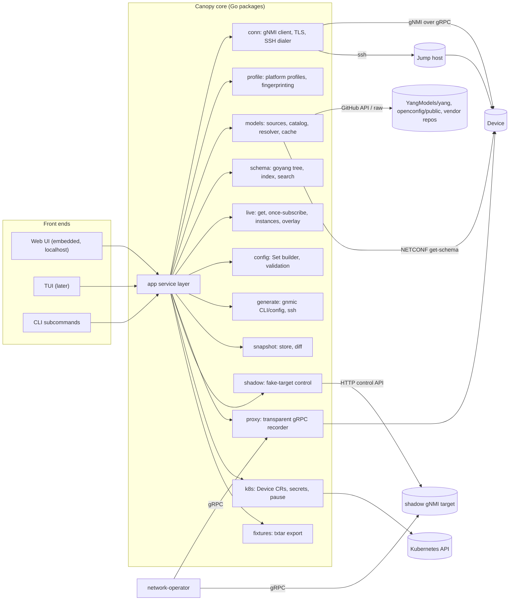

# Canopy — Architecture and Build Plan

Canopy is a vendor-agnostic, cross-platform browser for gNMI devices. It loads the
correct YANG models for a device's vendor and software version, lets you traverse the
schema tree, overlays live data from the device, and turns what you select into
reusable artifacts: JSON/YAML data, gNMIc commands and configs, gNMI Set payloads,
snapshots, diffs and test fixtures.

It is built as a standalone tool. It integrates with the IronCore
[network-operator](https://github.com/ironcore-dev/network-operator) through public
interfaces only (Kubernetes API, gRPC on the wire, the operator's fake gNMI server),
never through the operator's Go `internal/` packages.

---

## 1. Goals and non-goals

### Goals

1. **Vendor agnostic.** Adding a vendor or OS release means adding a *platform
   profile* and making its models available, not writing code.
2. **YANG-first.** The schema tree is the primary view, because it shows what *can*
   exist, including features nobody has configured. Live data is an overlay.
3. **Correct models per device.** Detect vendor, OS and version; select matching
   models, including deviations; warn loudly on mismatches.
4. **Reach any device.** Direct gNMI, or through one or more SSH jump hosts.
5. **Turn exploration into artifacts.** Copy data as JSON/YAML; generate `gnmic`
   commands and config; build validated Set payloads; export snapshots and
   network-operator test fixtures.
6. **Operator-aware, not operator-coupled.** Inventory from Device CRs, pause handling,
   recording proxy, and shadow-target dry runs.
7. **macOS and Windows first, Linux as a bonus**, from a single static Go binary.
   macOS and Windows are the main desktop platforms and must be first-class: tested in
   CI, packaged, and with native SSH agent and keychain support. Linux builds come for
   free from the same code but get best-effort support.

### Non-goals (for now)

- Not a production telemetry collector. Canopy *generates* gNMIc collector config;
  gNMIc runs it.
- Not a configuration management system. Sets are interactive and explicit.
- No automatic mapping between vendor-native and OpenConfig paths.

---

## 2. Key use cases

| Use case | Outcome |
|---|---|
| Explore a device | Connect, see the correct YANG tree for its version, find a path, load its data |
| Find where something lives | Search the schema; list live instances with concrete paths and values |
| Learn how to configure something | Schema details (types, enums, defaults, `when`/`must`, leafrefs), current config, a generated Set payload and `gnmic set` command |
| Integration work | Show raw YANG source of a node (file, line, grouping, augment, deviation); export the module set for a platform |
| Collect data | Mark paths, get `gnmic get`/`subscribe` commands and a gNMIc config block |
| Compare | Diff two snapshots (before/after, device vs device, vendor vs vendor) |
| Operator dry run | Seed a shadow target from a real device; point a Device at it; see what the operator would change |
| Operator regression tests | Export `.txtar` fixtures in the format `test/gnmi` already uses |

---

## 3. Design principles

- **Local-first, safe by default.** The UI binds to `127.0.0.1` with a random session
  token. Writes to devices need an explicit confirmation step and show the exact
  payload and equivalent command first.
- **Immutable, content-addressed caches.** Models are cached by Git blob SHA or by
  device fingerprint; snapshots are stored with full provenance.
- **Black-box integration.** Canopy observes what the operator *actually* does on the
  wire rather than re-implementing provider logic.
- **One core, several front ends.** All logic lives in Go packages with no UI
  dependencies. The web UI is the first front end; a TUI (`tview`) for use directly on
  jump hosts can follow.
- **Agent-testable.** Development happens without devices; testing happens on a
  separate work device with an AI agent (see `testing/README.md`). Every feature the
  UI offers that doesn't depend on rendering is reachable from the CLI with
  machine-readable output, so an agent can test it without driving a browser.

---

## 4. High-level architecture



---

## 5. Components

### 5.1 Connection (`conn`)

- gNMI client built directly on `github.com/openconfig/gnmi` and
  `google.golang.org/grpc`, **not** on `gnmic/pkg/api`. gNMIc's `CreateGNMIClient`
  accepts extra `grpc.DialOption`s but appends its own `grpc.WithContextDialer`
  afterwards, so a caller-supplied SSH dialer would be overridden. Its only proxy
  support is SOCKS5. (Checked on gNMIc `main`, November 2026.) Canopy still emits
  gNMIc-compatible commands and config; it just doesn't use gNMIc as a library.
- **TLS modes:** plaintext, TLS with skip-verify, TLS with CA, mutual TLS, and a
  server-name override (needed when the dial address differs from the certificate
  name, for example through tunnels or proxies).
- **Credentials:** username/password as per-RPC gRPC metadata (`username`, `password`),
  matching how the operator authenticates. Never persisted unless the user opts into
  the OS keychain (`github.com/zalando/go-keyring`).
- **SSH jump hosts** via `golang.org/x/crypto/ssh`:
  - The gRPC dialer opens `direct-tcpip` channels through the SSH client. No local
    port, no external `ssh` process.
  - Chains of jump hosts (ProxyJump semantics).
  - Auth: ssh-agent, key files with passphrase prompt, password. Agent access differs
    per platform:
    - macOS and Linux: Unix socket from `SSH_AUTH_SOCK` (`x/crypto/ssh/agent`).
    - Windows: the built-in OpenSSH agent listens on the named pipe
      `\\.\pipe\openssh-ssh-agent`, dialed with `github.com/Microsoft/go-winio`.
      Pageant (PuTTY) as a second option, for example with
      `github.com/davidmz/go-pageant`.
  - Default paths follow each OS: `~/.ssh` on macOS, `%USERPROFILE%\.ssh` on Windows.
  - `~/.ssh/config` support (`github.com/kevinburke/ssh_config`) for `HostName`,
    `User`, `Port`, `IdentityFile`, `ProxyJump`.
  - Host key verification through `known_hosts`
    (`x/crypto/ssh/knownhosts`); unknown keys require explicit trust in the UI.
- **NETCONF** (optional, for fetching models from the device): over the same SSH
  machinery, using `github.com/nemith/netconf` or `scrapligo`.
- gRPC message size limits raised (for example 256 MiB receive) because full-tree
  responses are large.

### 5.2 Platform profiles (`profile`)

A profile captures everything vendor- or release-specific. Profiles are YAML, shipped
with defaults and overridable by the user or a team repository.

```yaml
# profiles/cisco-nxos.yaml
id: cisco-nxos
vendor: cisco
os: nxos
fingerprint:
  # all listed rules are tried; first match wins
  - capabilitiesModuleRegex: '^Cisco-NX-OS-device$'
version:
  # NX-OS: the revision of Cisco-NX-OS-device in Capabilities identifies the release.
  # This is how the operator detects it (internal/provider/cisco/nxos/version.go).
  fromCapabilities:
    module: Cisco-NX-OS-device
    revisions:
      "2024-03-26": "10.4(3)"
      "2024-10-17": "10.4(4)"
      "2025-03-01": "10.4(5)"
      "2025-08-30": "10.4(6)"
      "2024-07-25": "10.5(1)"
      "2024-11-26": "10.5(2)"
      "2025-04-23": "10.5(3)"
      "2025-08-12": "10.6(1)"
      "2025-12-12": "10.6(2)"
      "2026-04-24": "10.6(3)"
  # fallback: read it from the device
  getPath: /System/showversion-items/nxosVersion   # illustrative, verify
  # how a version maps to a folder in model sources (YangModels/yang vendor/cisco/nx)
  normalize:
    - match: '^(\d+)\.(\d+)\((\d+)\)$'     # e.g. 10.4(3)
      folder: '$1.$2-$3'                   # e.g. 10.4-3
models:
  sources:
    - source: yangmodels
      path: vendor/cisco/nx/{folder}
    - source: openconfig
  fallback: nearest-lower   # nearest-lower | nearest | none
gnmi:
  encoding: json            # preferred; validated against Capabilities
  origins:
    native: ""              # vendor-native paths
    openconfig: openconfig
  setEncoding: json
probe:
  excludePaths:             # never scanned in bulk
    - /System/urib-items
operator:
  provider: nx.cisco.networking.metal.ironcore.dev   # Device.spec.provider
  fixtureDir: nx.cisco.networking.metal.ironcore.dev # test/gnmi/testdata/<dir>
```

The NX-OS revision map and the provider name are taken from the operator. The
`getPath` and `probe` values are illustrative and must be verified on a device.

**Operator provider names** (registered with `provider.Register`; the same strings
are used as `Device.spec.provider` and as fixture directory names):

| Provider | Name | Fixtures in `test/gnmi/testdata` |
|---|---|---|
| Cisco NX-OS | `nx.cisco.networking.metal.ironcore.dev` | yes |
| Cisco IOS XR | `iosxr.cisco.networking.metal.ironcore.dev` | no |
| Nokia SR Linux | `srlinux.nokia.networking.metal.ironcore.dev` | yes |
| OpenConfig | `openconfig.networking.metal.ironcore.dev` | yes |

Only NX-OS has explicit version detection in the operator. The SR Linux, IOS XR and
OpenConfig providers don't detect versions, so Canopy's profiles for those need
their own rules.

**Fingerprinting order:**

1. gNMI Capabilities (module names and organizations usually identify the vendor).
2. The profile's `version.getPath` Get (or OpenConfig
   `/system/state/software-version`, `/components/component/state/software-version`).
3. NETCONF hello or `ietf-yang-library`, when available.

The result is a `Platform{vendor, os, version, folder}` that drives model selection.

### 5.3 Model sources, catalog and resolver (`models`)

This is the core of correctness. Canopy must **list, search and fetch YANG models from
large public repositories without cloning them**.

#### Source types

| Type | Use | Mechanism |
|---|---|---|
| `github` | YangModels/yang, openconfig/public, vendor repos | GitHub REST API for tree listings, `raw.githubusercontent.com` for content |
| `git` | Any Git host, offline mirrors, private repos | Partial clone `--filter=blob:none` plus sparse checkout of only the needed folders |
| `local` | A folder on disk, the user's own model store | Directory walk |
| `device` | Models straight from the device | NETCONF `get-schema` (RFC 6022) |

Default sources (configurable):

```yaml
sources:
  - id: yangmodels
    type: github
    repo: YangModels/yang
    ref: main            # resolved to a commit SHA and pinned per catalog snapshot
  - id: openconfig
    type: github
    repo: openconfig/public
    ref: v4.x            # pin a release tag that matches the platform's OC support
  # vendors not in YangModels/yang get their own source, for example:
  # - id: arista
  #   type: github
  #   repo: aristanetworks/yang
```

#### Facts about YangModels/yang that shape the design

- Layout: `standard/` (ietf, ieee, iana, bbf, etsi, itu, mef), `vendor/`,
  `experimental/`. Default branch `main`.
- `vendor/cisco` is a regular directory, organized per OS and release:
  - `xr/<release>` with the dots removed (`530` is IOS XR 5.3.0).
  - `xe/<release>` (`1631` is IOS XE 16.3.1).
  - `nx/<release>` with parentheses turned into dashes (`7.0-3-I5-1` is
    7.0(3)I5(1)).
- Several vendor and standard folders are **Git submodules** pointing to other
  repositories (for example `vendor/nokia`, `vendor/juniper`, `vendor/huawei`,
  `standard/bbf`). A submodule appears in the Git tree as a `commit` entry; Canopy
  must read `.gitmodules`, follow the URL, and list that repository at the pinned
  commit. One submodule (readylinks) lives on GitLab; non-GitHub submodules are
  skipped with a visible notice until a `gitlab` source exists.
- **OpenConfig models are not in this repository**, and Arista is not under `vendor/`.
  Both need their own sources.
- The repository is very large. Never list it recursively from the root in one call.

#### Release layouts per vendor

Checked in November 2026. Each one needs a `normalize` rule in its profile.

| Vendor / OS | Where | Release naming | Example |
|---|---|---|---|
| Cisco IOS XR | YangModels/yang `vendor/cisco/xr/` | Dots removed. Newer releases use 4 or 5 digits (for example `2421`, `24221`), which the README doesn't explain; year-based numbering (24.2.1) is likely but unverified | `530` = 5.3.0, `7921` |
| Cisco IOS XE | YangModels/yang `vendor/cisco/xe/` | Dots removed | `1631` = 16.3.1 |
| Cisco NX-OS | YangModels/yang `vendor/cisco/nx/` | `show version` string, parentheses turned into `-` | `10.4-3` = 10.4(3), `7.0-3-I5-1` |
| Juniper Junos | Juniper/yang (submodule `vendor/juniper`) | `major.minor/` folder, then release folders inside, with separate `-EVO` builds | `23.4/23.4R2`, `23.4/23.4R2-EVO` |
| Huawei | Huawei/yang (submodule `vendor/huawei`) | Product folder, then version without the `V` | `network-router/8.22.0` |
| Nokia SR Linux | nokia/srlinux-yang-models | **Git tags**, not folders. `main` has no YANG files | tag `v25.10.3` |
| Nokia SR OS | nokia/7x50_YangModels | Not checked yet | — |
| Arista EOS | aristanetworks/yang | `EOS-<version>` folders; each has `release/openconfig/models` with Arista's OpenConfig augmentations and deviations, plus `experimental/` | `EOS-4.31.0F` |
| OpenConfig | openconfig/public | Git tags `vX.Y.Z`; models under `release/models/` | `v5.11.0` |

Two consequences for the `github` source:

- It must support **ref per release** (tag or branch), not only a path inside one
  pinned ref, because SR Linux and OpenConfig version by tag.
- Nokia's submodule in YangModels/yang points to `nokia/YangModels`, which itself
  contains submodules (`7x50_YangModels`, `srlinux-yang-models`). Submodule resolution
  must be recursive.

#### Catalog

The catalog is a local index of *what exists* in each source, built lazily.

- **Listing:** GitHub Git Trees API per directory
  (`GET /repos/{owner}/{repo}/git/trees/{sha}`), recursing only into folders the user
  or a profile asks for (for example `vendor/cisco/nx/10.4-3?recursive=1`).
  Recursive listings truncate at large sizes; handle `truncated: true` by falling back
  to per-directory listing.
- **Indexed per file:** source, commit SHA, path, blob SHA, module name and revision
  parsed from the file name (`name@YYYY-MM-DD.yang`, falling back to content), vendor,
  OS and release folder when the path matches a known pattern.
- **Enriched lazily** when a file is fetched: `module` or `submodule`, `namespace`,
  `prefix`, `revision`, `oc-ext:openconfig-version`, imports, includes, and whether it
  is a deviation module.
- **Storage:** SQLite through `modernc.org/sqlite` (pure Go, no CGo) with FTS for
  search across module names, prefixes, namespaces and descriptions.
- **Search in the UI:** by module name, prefix, namespace, OpenConfig version, vendor,
  OS and release; "which releases contain module X"; "which modules does release Y
  have".
- **Rate limits:** unauthenticated GitHub API calls are heavily rate limited. Canopy
  uses `GITHUB_TOKEN`, or the token from `gh auth token` if available, and caches
  tree listings by tree SHA, so repeat listings are free. File contents come from
  `raw.githubusercontent.com` pinned to a commit SHA.

#### Cache

- File contents cached by **blob SHA** (content addressed, immutable, shared across
  releases that contain identical files).
- Tree listings cached by **tree SHA**.
- Location: OS user cache directory (`os.UserCacheDir()/canopy`).
- `canopy models prefetch --profile cisco-nxos --version 10.4(3)` warms the cache
  for offline use (for example before working from an isolated jump host).

#### Resolver

Given a platform and the device's Capabilities, the resolver builds the exact module
set to load:

1. Start with the modules the device advertises (name and revision or OpenConfig
   version).
2. Look each one up in the profile's sources, in order. For OpenConfig modules, match
   on `oc-ext:openconfig-version`, not on revision dates, because Capabilities report
   the semantic version.
3. Add the transitive closure of `import` and `include`. Imports resolve in this order:
   same release folder, then the profile's sources in order, then `standard/ietf` and
   `standard/iana`.
4. Add deviation modules that target any module in the set (detected from
   `deviation` statements while enriching).
5. Fetch only that closure.
6. Produce a **match report**: exact matches, version mismatches, advertised but
   missing modules, and any fallback to a nearest release. The UI shows this report
   before the tree, and every node of an unmatched module is flagged.

### 5.4 Schema engine (`schema`)

- Parsing with `github.com/openconfig/goyang`. It handles augments, uses/groupings,
  choices and deviations, and keeps source locations.
- **Node index:** flat map from a stable node ID to its schema data: kind (container,
  list, leaf, leaf-list, choice, case), name, defining module, config/state, type
  details (base type, ranges, patterns, enums, union members, leafref target), keys,
  default, mandatory, `when`, `must`, description, and source location (file and
  line). Choice and case are kept for display but skipped when building data paths.
- **Data paths:** generated with list keys as wildcards
  (`/interfaces/interface[name=*]/state/counters`) and module prefixes or origin added
  where the profile requires them.
- **Provenance:** for each node, the chain of grouping, augment and deviation that
  produced it, so the UI can answer "why does this node look like this on this
  vendor?".
- **Search:** by node name, path fragment or description, with results ranked by path
  depth.
- **Lazy children:** the UI requests children on demand. Full OpenConfig trees have
  tens of thousands of nodes.
- Parsed trees cached per resolved module set (a hash of the blob SHAs).

### 5.5 Live data (`live`)

- **Get** on selected paths with type ALL, CONFIG, STATE or OPERATIONAL, and the
  encoding chosen from the profile and validated against Capabilities.
- **Bulk reads through Subscribe ONCE**, which streams notifications instead of one
  large Get response. Used for subtree loads and scans.
- Results are kept as **notifications with full paths and explicit list keys**, not
  just as JSON, so instances and keys are exact.
- **Instances view:** for a schema node, run a wildcard read and list every concrete
  instance path with its value.
- **Overlay:** schema nodes are marked as populated, empty, or error. Errors are
  classified by gRPC status (for example `NotFound` versus `Unimplemented` or
  `InvalidArgument`) to hint "supported but empty" versus "not supported". Vendors are
  inconsistent, so this is shown as a hint, not a fact.
- **Exclusions:** profile `probe.excludePaths` (RIBs, FIBs, large counters) are never
  read in bulk.
- **OpenConfig config/state pairing:** a state leaf links to its `config` sibling and
  the other way around.

### 5.6 Configuration (`config`)

- **Payload builder:** from a selected config node, produce a JSON_IETF (or
  profile-preferred encoding) payload with list keys, mandatory leaves, defaults shown,
  and enums offered as choices.
- **Start from reality:** optionally prefill from the device's current config (Get with
  type CONFIG).
- **Validation** against the YANG types before sending (goyang type info; consider
  `ygot`'s `ytypes` validation for generated structs later).
- **Operation choice:** update (merge), replace, or delete, with replace and delete
  clearly flagged as destructive.
- **Safety:**
  - Preview the SetRequest and the equivalent `gnmic set` command before sending.
  - Dry-run mode sends nothing.
  - Optional pre-snapshot of the affected subtree, with a diff after the Set.
  - If the device is managed by the operator, require it to be paused first
    (see 5.10).
  - Use commit-confirmed only where the device supports the OpenConfig extension.

### 5.7 Generators (`generate`)

From any selection of paths and the current connection:

- `gnmic get`, `gnmic subscribe` (once, poll, stream with sample or on-change),
  `gnmic set` (update, replace, delete, with value files).
- A **gNMIc config file block** (targets, subscriptions, outputs) to paste into
  collectors.
- `ssh -L` or `ssh -J` equivalents when a jump host is used, plus the gNMIc address
  rewritten to the tunnel.
- Selected data copied as **JSON, YAML, or flat path=value lines**.
- Passwords are never embedded. Commands reference `$GNMI_USERNAME` and
  `$GNMI_PASSWORD` instead.

### 5.8 Snapshots and diff (`snapshot`)

- A snapshot is a set of notifications plus provenance: device, platform, resolved
  module set hash, paths, read type, encoding, timestamp, and Canopy version.
- Stored as compressed JSON in the user data directory, exportable and importable.
- **Diff** at the path level (added, removed, changed), rendered as a tree. Works for
  before/after, device versus device, and vendor versus vendor when paths are
  comparable (for example both OpenConfig).

### 5.9 Recording proxy (`proxy`)

- A **transparent gRPC proxy** that forwards every service and method, not just gNMI
  (gNOI is used too, for example certificate loading), using an unknown-service
  handler with raw codec passthrough.
- Decodes and records gNMI messages it understands (Capabilities, Get, Set, Subscribe);
  stores other services as opaque frames with method names.
- **NX-API is plain HTTP(S), not gRPC.** The operator's NX-OS provider sends NX-API
  requests (`show running-config`, copying the running config to startup, rollback,
  reload) to the **same IP** as `spec.endpoint.address` but on port 443 (or 80 without
  TLS) by default, reusing the endpoint's TLS settings
  (`internal/transport/nxapi/nxapi.go`). If the Device address is rewritten to the
  proxy, the proxy must also serve an **HTTP(S) reverse proxy on 443/80** for NX-OS
  devices, or those calls fail.
- Recorded sessions feed snapshot diffs and the "what did the operator send?" view.
- **TLS:** the operator verifies the endpoint against the CA in the Device spec, so the
  proxy must terminate TLS with a certificate the operator trusts and re-originate TLS
  to the device.
- **Addressing:** `Device.spec.endpoint.address` only accepts **IPv4:port** (pattern
  enforced in the CRD). The proxy needs a stable IPv4 the operator can reach, for
  example a Kubernetes Service ClusterIP when it runs in-cluster.

### 5.10 Operator integration (`k8s`)

Uses the client-go **dynamic client** with unstructured objects, so CRD changes in
`v1alpha1` do not break the build; typed views only where they add value.

Verified facts from the operator repository:

- **Device spec:**
  - `spec.endpoint.address`: IPv4:port.
  - `spec.endpoint.secretRef`: a `kubernetes.io/basic-auth` Secret with `username`
    and `password`.
  - `spec.endpoint.tls`: CA and optional client certificate.
  - `spec.provider`: selects the vendor provider.
  - `spec.paused`: pauses the Device and all its child resources.
- **Pause:**
  - Annotation `networking.metal.ironcore.dev/paused` on any resource pauses that
    resource. `kubectl net pause` sets it with a JSON merge patch.
  - Child resources are also paused when the Device has the
    `networking.metal.ironcore.dev/maintenance` annotation, is not in phase `Running`,
    or is not reachable.
  - Effective state is reported as a `Paused` status condition.

Canopy features:

- **Inventory** from Device CRs in the current kube context; credentials from the
  referenced Secrets (needs RBAC to read them).
- **Pause and resume** by setting and removing the annotation (or `spec.paused`), then
  waiting for the `Paused` condition to become true before allowing manual Sets.
- **CR view:** a Device's child resources next to the live device subtree they
  affect.
- **Proxy insertion:** temporarily rewrite `spec.endpoint.address` to the proxy,
  and restore it afterwards, with a clear banner while active.

#### Two connection modes

| Mode | Connects to | Purpose |
|---|---|---|
| **Device mode** | A device directly (optionally through jump hosts) | Development, debugging, exploration |
| **Operator mode** | A Kubernetes cluster running network-operator, and through it to the devices its Device CRs describe | Quality assurance: verify that what the operator was asked to do is what the devices actually have |

In operator mode the inventory, addresses, credentials and TLS settings all come from
the cluster, and devices are reached the same way the operator reaches them.

#### QA verification workflow

The core question: *after the operator reconciled a resource, does the device have
the expected state?*

1. **Select** a resource (for example a Banner) or a whole Device.
2. **Expected state** comes from one of:
   - the operator's own test fixture for that kind and provider (`state/expect` in
     `test/gnmi/testdata/<provider>/*.txtar`), when the CR matches;
   - what the operator actually sent, captured by the recording proxy;
   - an expectation the tester writes or saves from a known-good run (a "golden"
     snapshot).
3. **Actual state:** Canopy reads the relevant paths from the device.
4. **Verdict:** a path-level diff, plus the resource's own status (`Ready`,
   `Paused`, conditions) and the operator's log lines for that reconcile.
5. **Lifecycle checks:** apply, update a field, delete; check the device after each
   step (matching the fixtures' `expect` and `delete` states).
6. **Drift checks:** change the device out of band (lab only, approved), then confirm
   the operator restores it within its requeue interval.

Results are exportable as a QA report and, where useful, as new `.txtar` fixtures.

A local QA lab for this exists in `lab/` (SR Linux in containerlab plus
network-operator in kind with Tilt); see `lab/README.md`.

### 5.11 Shadow target and test fixtures (`shadow`, `fixtures`)

The operator's fake gNMI server (`test/gnmi/server/server.go`) is the starting
point for the shadow target. What the current code does:

- It is an **in-process Go test server** (`NewTestServer`) holding one JSON state
  buffer, edited with `sjson`. Tests seed it with `State().SetBuf(...)` and read it
  with `GetBuf()`.
- It implements Get, Set (delete, replace, update; not union-replace) and Subscribe
  ONCE.
- **Capabilities returns only the JSON encoding and no models.** The NX-OS provider
  detects its version from the `Cisco-NX-OS-device` revision in Capabilities, so
  against this server it sees an unknown version.
- The README describes a Docker image (`ghcr.io/ironcore-dev/gnmi-test-server`) with
  an HTTP API (`GET`/`DELETE /v1/state` on port 8000). That HTTP API and a standalone
  `main` were **not found in the current code**, so the README may be out of date.

Because of this, Canopy needs **its own shadow target**, built to the same state model
so fixtures stay compatible:

- A standalone gNMI server with the same JSON-buffer semantics.
- **Capabilities replayed from the snapshot** of the real device, so version-dependent
  provider logic behaves as it would on that device.
- An HTTP control API to load, read and clear state (`PUT`/`GET`/`DELETE`), matching
  the README's `/v1/state` where it overlaps.
- Optionally contribute it upstream to replace the stale README.

**Dry run flow:**
1. Snapshot a real device (Capabilities and state).
2. Load the snapshot into Canopy's shadow target.
3. Point a Device at it (for example in a throwaway kind cluster).
4. Let the operator reconcile.
5. Read the state and diff against the seed.
- **Fixture export:** the operator's gNMI tests use `.txtar` files per provider
  directory (for example `nx.cisco.networking.metal.ironcore.dev`,
  `srlinux.nokia.networking.metal.ironcore.dev`,
  `openconfig.networking.metal.ironcore.dev`). Each holds the CR YAML plus
  `state/preload`, `state/expect` and `state/delete` JSON. Canopy can write these
  from a real snapshot (`preload`) and an observed result (`expect`), so tests use
  realistic data.

Note: the fake server's state is shaped by the path elements it receives (for example
NX-OS native `System/...`). Fixtures must use the same path style as the provider.

### 5.12 Web UI (`web`)

- Single Go binary serves the UI from `go:embed`; opens the default browser
  (`github.com/pkg/browser`).
- Binds to `127.0.0.1` only; random token in the URL; token required on every API
  call and WebSocket.
- Frontend kept light: TypeScript with a small bundler (esbuild) or htmx plus small
  islands of JavaScript. No heavy framework is required. Requirements:
  - **Virtualized tree** for tens of thousands of nodes.
  - **Code viewer** (CodeMirror 6) for JSON, YAML and YANG source with highlighting.
  - Streaming updates over WebSocket for subscriptions and long reads.
- **Layout:**
  - Left: device selector (manual, gNMIc targets file, or Kubernetes), schema tree
    with search and overlay markers.
  - Center: node details (path, type, description, YANG source, provenance,
    config/state pair).
  - Right: tabs for data (JSON, YAML, flat), instances, config builder, generated
    commands, snapshots and diffs.
  - Footer: model match report and connection status.
- **Marking:** checkboxes on tree nodes and on data subtrees; the selection drives
  copying, generators and snapshots.

### 5.13 CLI

The same binary exposes subcommands for scripting, CI and **agent-driven testing**.
The CLI is a thin layer over the same `app` service layer the web UI uses, so it adds
little scope: each command is a few lines that call an existing service method and
print the result. Building it alongside the UI also keeps the core honest, because
nothing can hide in UI code.

**Rules that make it agent-friendly:**

- `--output json` on every command, with a stable, documented schema (versioned
  field `schemaVersion`). Human-readable text is the default.
- Non-interactive: no prompts when `--non-interactive` is set or stdin isn't a
  terminal. Secrets come from environment variables (`GNMI_USERNAME`,
  `GNMI_PASSWORD`, `CANOPY_SSH_PASSPHRASE`) or the SSH agent; host-key trust from
  `--accept-host-key <fingerprint>`.
- Stable exit codes: `0` success, `1` usage error, `2` connection or auth failure,
  `3` device returned an error (gRPC code in the JSON output), `4` model or schema
  error, `5` internal error.
- `--log-level debug --log-file <path>` with structured JSON logs, so a report can
  attach the exact log window of a test case.
- Errors in JSON output always carry a machine-readable `code` and the gRPC status
  where one exists.

**What stays UI-only** and is tested by the human: rendering, tree scrolling and
responsiveness, clipboard copy, and visual layout. The test plans mark these cases.

Commands:

```text
canopy version                             # version, commit, build date
canopy ui                                  # start the web UI
canopy connect --target ... --jump ...     # test connectivity, print capabilities
canopy fingerprint --target ...            # print detected platform
canopy models list|search|prefetch|report  # catalog operations
canopy tree --yang <dir> [--path ...]      # print schema tree (pyang-like), search with --find
canopy get --target ... --path ... [--type config|state] [--format json|yaml|flat]
canopy generate gnmic --target ... --path ... [--mode get|once|stream]
canopy collect --target ... --out <dir>    # device data pack (replaces gNMIc in canopy-collect)
canopy snapshot --target ... --path ...    # save a snapshot
canopy diff a.snap b.snap
canopy fixture export --snapshot ... --cr ... --provider-dir ...
canopy proxy --listen ... --upstream ...
```

---

## 6. Repository layout

```text
canopy/
  cmd/canopy/            # main, cobra commands
  internal/
    app/                 # service layer used by all front ends
    conn/                # gNMI client, TLS, credentials
    sshx/                # SSH dialer, jump chains, ssh_config, known_hosts
    netconf/             # get-schema client
    profile/             # profile loading, fingerprinting
    models/              # sources (github, git, local, device), catalog, resolver, cache
    schema/              # goyang loading, index, paths, search, provenance
    live/                # get, once-subscribe, instances, overlay
    config/              # payload builder, validation
    generate/            # gnmic CLI and config, ssh, data formats
    snapshot/            # store, diff
    proxy/               # transparent gRPC proxy, recorder
    k8s/                 # dynamic client, devices, secrets, pause
    shadow/              # fake gNMI server control
    fixtures/            # txtar export
    web/                 # HTTP API, WebSocket, embedded assets
  web/                   # frontend sources (built into internal/web/dist)
  profiles/              # built-in platform profiles
  docs/
  test/                  # integration tests (fake server, containerlab)
```

`internal/` keeps the API surface private until something needs to be shared; promote
packages to `pkg/` deliberately.

---

## 7. Dependencies

| Area | Choice |
|---|---|
| gNMI | `github.com/openconfig/gnmi`, `google.golang.org/grpc` |
| YANG | `github.com/openconfig/goyang` (optionally `ygot` later) |
| SSH | `golang.org/x/crypto/ssh`, `.../agent`, `.../knownhosts`, `github.com/kevinburke/ssh_config` |
| NETCONF | `github.com/nemith/netconf` or `github.com/scrapli/scrapligo` |
| Kubernetes | `k8s.io/client-go` (dynamic), `sigs.k8s.io/yaml` |
| Storage | `modernc.org/sqlite` (pure Go) |
| CLI | `github.com/spf13/cobra` |
| YAML/JSON | `gopkg.in/yaml.v3`, `encoding/json` |
| Fixtures | `golang.org/x/tools/txtar` |
| Keychain | `github.com/zalando/go-keyring` (macOS Keychain, Windows Credential Manager; optional) |
| Windows SSH agent | `github.com/Microsoft/go-winio` (named pipe), `github.com/davidmz/go-pageant` (optional) |
| Browser open | `github.com/pkg/browser` |
| Frontend | CodeMirror 6, a virtualized tree component, esbuild |

**No CGo anywhere**, so `GOOS`/`GOARCH` cross-compilation works for all targets.

---

## 8. Security

- UI bound to loopback, token-protected, no CORS, strict Content-Security-Policy.
- Credentials kept in memory only; optional OS keychain; never written to snapshots,
  logs, generated commands or browser storage.
- SSH host keys verified; first-use trust requires explicit confirmation.
- Device writes require explicit confirmation, show the payload first, and require the
  operator to be paused for managed devices.
- Kubernetes access uses the user's kube context and RBAC; Canopy never escalates.
- A future shared mode (running on a jump host for a team) needs real authentication
  and is out of scope for the first releases.

---

## 9. Build, release and platforms

- Go version matching the operator repository's toolchain where practical.
- **Platform priority:** macOS and Windows are primary; Linux is best-effort.
- `goreleaser` builds for `darwin/arm64`, `darwin/amd64`, `windows/amd64`,
  `windows/arm64` (primary) and `linux/amd64`, `linux/arm64` (best-effort).
- Tests run on macOS and Windows CI runners on every PR (paths, SSH agent, keychain and
  browser launch differ per OS); Linux runs integration tests with the fake gNMI server
  container.
- Frontend built once (`npm ci && npm run build` or a Go-driven esbuild step) and
  embedded; the Go build needs no Node toolchain when `dist/` is committed or produced
  in CI.
- macOS: signed and notarized binaries for distribution outside the team; Homebrew tap.
- Windows: Scoop or winget manifest.
- CI: lint (`golangci-lint`), unit tests, integration tests against the operator's
  fake gNMI server image, and later a Containerlab job with real NOS images where
  licenses allow.

---

## 10. Milestones

| # | Milestone | Scope |
|---|---|---|
| M1 | **Connect and browse** | Direct gNMI and one jump host; Capabilities; YANG from a `local` folder; schema tree with search; Get on a node; copy JSON/YAML; `gnmic get` and `subscribe` generation. CLI: `version`, `connect`, `tree`, `get`, `generate gnmic`, all with `--output json` |
| M2 | **Model catalog** | `github` source for YangModels/yang (submodules included) and openconfig/public; catalog with search; resolver with match report; cache and prefetch |
| M3 | **Platform awareness** | Profiles and fingerprinting for the first vendors (Cisco NX-OS, Nokia SR Linux, an OpenConfig-first platform); version-to-folder mapping; overlay and instances view |
| M4 | **Config and snapshots** | Payload builder, validation, guarded Set; snapshots and diff; NETCONF `get-schema` source |
| M5 | **Operator integration** | Operator mode: Kubernetes inventory, QA verification workflow (expected vs actual per resource), pause and resume, shadow target dry run, txtar fixture export. Developed against the local QA lab |
| M6 | **Recording proxy** | Transparent gRPC proxy with gNMI decoding and NX-API passthrough; proxy insertion workflow |
| M7 | **Polish** | TUI front end, keychain, packaging, docs |

M1 is useful on its own: it already replaces most ad-hoc `gnmic` exploration.

**Status (2026-11-13): all milestones are implemented.**

- M1: done.
- M2: done. `github` sources by tag or folder, Git submodules followed recursively to
  the pinned commit (Juniper, Huawei, Nokia in YangModels/yang), the SQLite catalog
  (`internal/catalog`, `modernc.org/sqlite`, FTS5) indexing downloaded releases in full
  and other releases from file listings, the match report, and `models prefetch`.
  The cache is per release; `models cache`, `models rm` and `models share` (identical
  files stored once as hard links, on request) manage its size.
  Maybe one day: an automatic content-addressed cache (blob SHA, files shared
  without asking).
  Decided against (2026-11-13): a `git` source and configurable or forked
  sources. Canopy uses the built-in public repositories only; models from anywhere
  else are loaded from a local folder (`--yang`, Local folder in the UI) or taken
  from the device over NETCONF (`models from-device`).
- M3: done. YAML platform profiles (`internal/models/profiles`, user overrides in
  `<config>/profiles`) for SR Linux, NX-OS, IOS XR, IOS XE, Junos, Huawei, SR OS, EOS
  and OpenConfig. The version paths of IOS XR, IOS XE, Junos, SR OS and EOS are
  unverified on devices.
- M4: done, including the `device` model source: NETCONF `get-schema`
  (`internal/netconf`), verified against SR Linux.
- M5, M6: done.
- M7: done: keychain, packaging, docs, and the TUI (`canopy tui`, `internal/tui`, tview).

Earlier status (2026-11-12): M1 done. M2 partly done (`internal/models`): `github` sources
versioned by tags (tarball, SR Linux, OpenConfig) or folders (Trees API plus raw files,
YangModels/yang NX-OS, IOS XR, IOS XE); listings and model sets cached in the user cache
folder; shared IETF folders used only to resolve imports; modules with missing imports
skipped with a warning; platform detection for SR Linux (version path) and NX-OS
(`Cisco-NX-OS-device` revision), nearest-lower version fallback; UI model picker and
auto-load on connect. Still open for M2: SQLite catalog with search, submodule
resolution (Juniper, Huawei, Nokia SR OS), resolver match report, prefetch. Also done
ahead of plan: saved connections (presets) and several devices connected at once.

---

## 11. Questions

### Answered

Checked against network-operator (commit `3e70e998`, 2026-11-10) and the public
repositories in November 2026.

| # | Question | Answer | Where in this doc |
|---|---|---|---|
| 1 | Version-to-folder rules per vendor | Known for Cisco XR, XE and NX, Juniper, Huawei, SR Linux, Arista and OpenConfig | 5.3, release layouts |
| 2 | Sources outside YangModels/yang | openconfig/public (tags), aristanetworks/yang (folders), nokia/srlinux-yang-models (tags) | 5.3 |
| 3 | Device-reported versions | NX-OS: revision of `Cisco-NX-OS-device` in Capabilities, as the operator does. Other providers in the operator don't detect versions | 5.2 |
| 4 | gNMIc API with a custom dialer | No: its own dialer overrides the caller's; only SOCKS5 proxying. Use `openconfig/gnmi` directly | 5.1 |
| 5 | NX-API service | Not gRPC: HTTP(S) to the device IP on 443/80. The proxy needs an HTTP reverse proxy too | 5.9 |
| 6 | Fake server seeding | In-process only (`SetBuf`); no HTTP API in the code; Capabilities has no models. Canopy builds its own shadow target | 5.11 |
| 7 | Operator provider names | `nx.cisco…`, `iosxr.cisco…`, `srlinux.nokia…`, `openconfig.networking.metal.ironcore.dev`; same strings as fixture folders (no IOS XR fixtures yet) | 5.2 |

### Still open

1. **Cisco IOS XR 4- and 5-digit folders** (`2421`, `24221`). Probably year-based
   releases (24.2.1, 24.2.21); confirm against a device or Cisco's notes.
2. **Nokia SR OS layout** in `nokia/7x50_YangModels`, and the exact OpenConfig version
   folders inside `openconfig/public` `release/models`.
3. **Version detection for IOS XR, Arista and OpenConfig-only devices.**
   The operator has no rule to copy; pick a path per platform and test it on a device.
   SR Linux is answered by the local lab: `/system/information/version` with
   `json_ietf` and no origin returns `v26.7.1-554-g78ed635f70a` on 26.7.1.
4. **Stale fake-server README.** Ask the operator team whether the Docker image with
   the `/v1/state` HTTP API still exists elsewhere, or whether the README should be
   fixed.
5. **GitLab-hosted submodules** (readylinks): needed early, or can a `gitlab` source
   wait? (Your decision.)
6. **Shared mode**: is a team-hosted deployment on a jump host a requirement, and if
   so, which authentication? (Your decision.)
